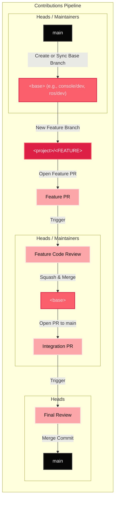
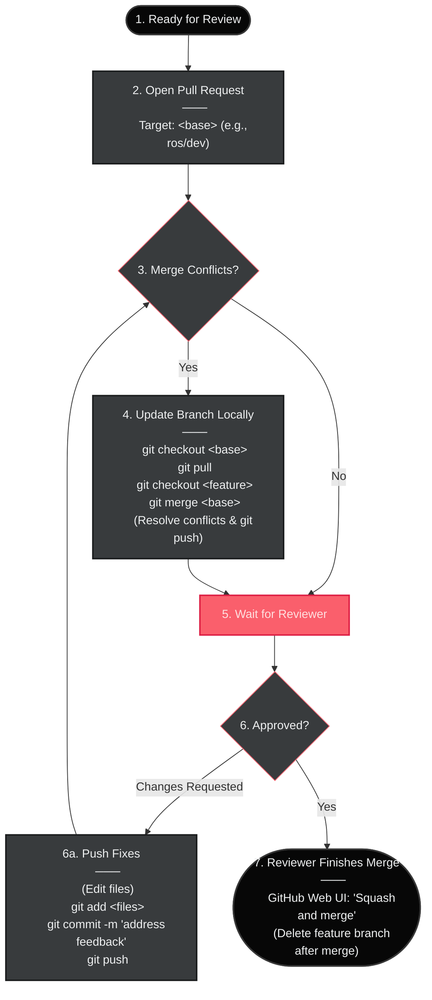

# ROV27

## Contributing

### Project Navigation

This is a monorepo. Every folder at the monorepo root level is treated as a separate subproject.

#### Opening a project

It is **not** recommended to directly open the monorepo root folder in your text editor or IDE. Please open the specific subproject folder you are working on.

#### Project list

| Project                          | Base Branch    | Description                                                             |
| -------------------------------- | -------------- | ----------------------------------------------------------------------- |
| [Monorepo](./)                   | `main`         | Structuring and root-level configuration of the monorepo                |
| [console](./console/README.md)   | `console/dev`  | GUI for remote control                                                  |
| [firmware](./firmware/README.md) | `firmware/dev` | Firmware for the on-board MCUs                                          |
| [network](./network/README.md)   | `network/dev`  | Configuration and scripts for network setup                             |
| [reports](./reports/README.md)   | `reports/dev`  | Deliverable documents required by the competition                       |
| [rov_ws](./rov_ws/README.md)     | `ros/dev`      | ROS2 project for on-board control, navigation, vision and communication |

---

### Branch Strategies

Each subproject isolates active development on its own base branch (`<base>`, e.g., `console/dev` or `ros/dev`), while `main` holds stable, integrated versions of all subprojects.



---

### Merge Strategy

We use a **two-tier merge strategy** to keep day-to-day contributions simple while preserving clear integration milestones on `main`:

1. **Feature PRs (`<project>/<FEATURE>` → `<base>`): Squash and merge**
* All commits in a feature branch are squashed into a single, descriptive commit on `<base>` (enforced via GitHub Rulesets).
* You do **not** need to rebase your feature branch just to clean up commit history. Only sync with `<base>` if GitHub reports merge conflicts or you need recent changes from `<base>`.
* **Important:** Once a feature PR is squash-merged, **delete the feature branch** and create a fresh branch from `<base>` for any future work.


2. **Integration PRs (`<base>` → `main`): Create a merge commit**
* When merging tested subproject updates from `<base>` into `main`, maintainers use **Create a merge commit** (not squash) so individual feature commits remain traceable on `main`.


#### Feature PR Workflow



---

### Cross-Project Work

When a task spans multiple subprojects (for example, changing a message format in `rov_ws` and updating its UI in `console`), keep each subproject's changes on its own feature branch targeting its respective `<base>` branch.

#### Working on Multiple Branches Simultaneously

* **Git Worktrees (Recommended):** Check out different branches into separate folders without duplicating the `.git` history (uses the `.git` directory of the original repository). \
From the `ROV27` root folder:
```sh
git worktree add ../<worktree-name> <branch-name>
```

if is recommended to use a descriptive name for `<worktree-name>` (e.g. `git worktree add ../ROV27-WT-<project> <branch-name>`). \
You can then open the subproject folder inside `ROV27-WT-<project>` directly in your editor.

* **Multiple Clones:** Alternatively, clone the repository into a second directory if you prefer completely separate clones.

#### Coordinating Linked PRs

* Open separate feature PRs for each affected subproject (e.g., one targeting `ros/dev` and one targeting `console/dev`) and cross-reference them in the PR descriptions (`Depends on #<PR_NUMBER>`).
* Avoid sharing a single feature branch across multiple subproject base branches when using squash merges, as squashing rewrites commit hashes and makes cross-branch tracking unreliable.
